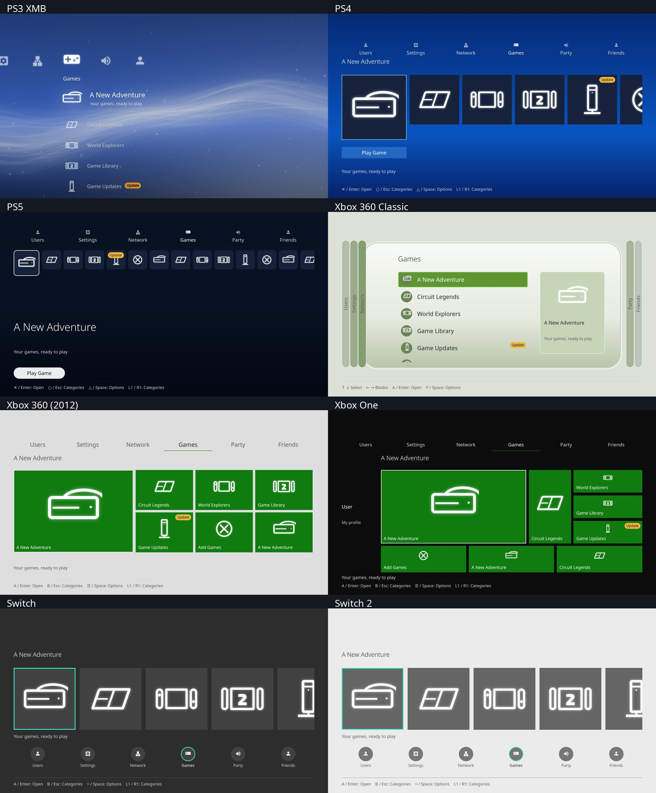

# Console themes

Settings → Theme Settings → Theme offers eight persistent looks. Older installations default to PS3 XMB;
an unrecognized saved theme falls back to XMB. Restoring default settings also restores XMB.

| Theme | Visual target |
| --- | --- |
| PlayStation 3 | Crossbar, vertical icon column, remembered category selection, animated silk, month colours and night dimming |
| PlayStation 4 | Blue field, function icon strip, large focused software tile and Start area |
| PlayStation 5 | Compact rounded software strip, game backdrop, large title and pill-shaped Play button |
| Xbox 360 Classic | Original silver/green blades, vertical menu and curved surround |
| Xbox 360 (2012) | Light Metro dashboard, large hero tile with six smaller tiles |
| Xbox One | Original dark dashboard, large software tile, tall secondary tile and stacked/low tiles |
| Nintendo Switch | Dark HOME menu, square software strip, mint focus frame and circular system shortcuts |
| Nintendo Switch 2 | Light HOME menu with the software strip, circular shortcuts and mint frame |



The preview uses made-up game titles and existing USCL console icons, without a personal profile or game
art. Actual game tiles use the library's icons and backgrounds. Console layouts are adapted to USCL's six
categories, rather than displaying nonfunctional store, media or console-service buttons. A theme changes
the launcher; emulator support is still determined by the installed USCL cores.

## Shared functionality

All themes use the same categories, selection, game launch/resume/close actions, friends, parties, online
sessions, game update/DLC actions and signed USCL updater. PS3 groups games by console. Modern dashboards
show the games directly, followed by Add Games, Game Updates and How to Play. Live update badges, running
game badges and status changes come from the same models.

Settings and library pages, choices/options, confirmation/progress dialogs, the online-name prompt,
notifications and clock use the selected palette. XMB-only colour/night/date preferences appear only in
XMB. The shared USCL boot/setup flow remains available in every look.

| Context | Controls |
| --- | --- |
| PS3 home | Left/right category, up/down item, L1/R1 jump five |
| Xbox 360 Classic home | Left/right blade, up/down item; L1/R1 also changes blade |
| Other home screens | Left/right item; up/down focuses categories (Xbox tile dashboards also navigate vertically); L1/R1 changes category |
| Category focus | Left/right category, confirm/down returns to items; Back toggles category focus |
| Inner settings pages | Up/down item, confirm opens, Back/left returns, L1/R1 jumps five |
| Modern game shelves | Left/right game; Back returns; up/down and L1/R1 remain available |
| Game actions | Confirm starts, Options/Space opens options, Info/I opens information |
| Mouse | Click to focus and again to open; right-click opens item options; home wheel moves selection |
| Long dialogs | Up/down or wheel scroll; L1/R1 scrolls further; left/right selects buttons |

Gamepad confirm/back continue to use the shell's existing physical-button mapping. Keyboard Enter and Esc
work in every theme. Choosing a theme retains the active page. Returning from a nested page restores the
parent selection. Empty/changing lists clamp selection safely. The 1920×1080 stage fits the window in both
axes, with margins on other aspect ratios. Hidden/off-screen home icons do not decode artwork.

## Original audio

`uscl-shell/tools/menu_sounds.py` creates every built-in WAV from oscillators, deterministic noise,
envelopes and stereo echoes. Cursor/category cues are brief, quiet ticks; confirm/back have different
pitch contours; startup uses a slowly detuned ensemble-style swell. There are no copied console recordings
or audio samples. Personal `<settings>/sounds/<cue>.wav` overrides continue to take precedence.

Regenerate from the repo root with `python uscl-shell/tools/menu_sounds.py`. Generated audio is 48 kHz,
16-bit stereo, with headroom and a final fade to zero.

## Verification

```
cmake -S uscl-shell -B shell-build -G Ninja -DCMAKE_BUILD_TYPE=Release -DUSCL_UI_TESTS=ON
cmake --build shell-build
ctest --test-dir shell-build --output-on-failure
python uscl-shell/tools/theme_smoke.py shell-build/uscl
```

On a Visual Studio build use `ctest --test-dir shell-build -C Release --output-on-failure` and pass
`shell-build/Release/uscl.exe` to the Python script.

The Qt Quick tests include packaged artwork and cover selection memory, category changes, disabled
items, empty/live lists, update badges, settings activation, game information, modern shelves, choices,
confirm/cancel, long release notes, and visibility of each selected tile across multiple dashboard pages.
The compiled-shell smoke test loads all eight themes, rejects QML/runtime/resource errors, checks that the
requested theme actually loaded, drives keyboard navigation through theme choices (including switching looks
and restoring the original), and checks stage bounds at 1280×720, 800×600 and 2560×1080. It uses
fresh temporary preferences and skips Steam startup, updates and automatic console-file setup. Windows CI
runs both suites in addition to the existing core self-test.

For repeatable synthetic screenshots, run the built `uscl-ui-tests` executable with
`-input uscl-shell/tools/tst_theme_previews.qml`. Images are written to the system temporary directory as
`uscl-preview-<theme>.png`.

Automated checks verify launcher controls and resource loading, not successful emulator launches, real
network sessions or update installation. Final visual matching, loudness/timbre and physical-controller
behaviour need in-person checks on the target display and OS. These are inspired implementations, not
pixel-identical console system software.

Visual references consulted: [PS3 XMB](https://www.xtremeps3.com/2007/11/07/ps3-firmware-20-available-to-download-tomorrow/),
[Xbox 360 blades](https://digiex.net/threads/use-the-xbox-360-blades-dashboard-version-1888-on-a-jtag.6802/),
[PS5 UI](https://blog.playstation.com/2020/10/15/first-look-playstation-5s-next-generation-user-experience/),
and [Nintendo Switch 2 HOME/settings](https://support.nintendo.com/hk/switch2/mastery/accessibility/index.html).
Reference screenshots and console audio are not included in the implementation.
